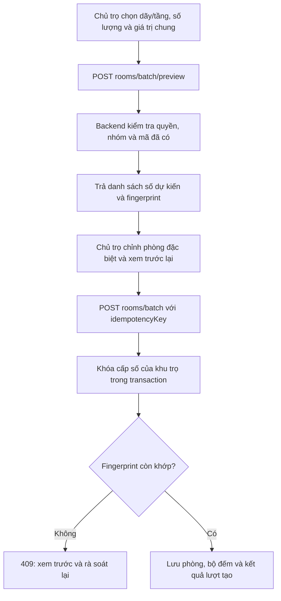

# Thay đổi cốt lõi: tạo nhiều phòng theo dãy/tầng

## Phạm vi đã triển khai

- Tạo nhiều nhóm trong một lượt, ví dụ tầng 1 có 20 phòng và tầng 2 có 20 phòng. Mỗi nhóm có diện tích, giá, sức chứa và mô tả chung.
- Xem trước số phòng do backend tính. Phòng đặc biệt có thể đổi riêng tên, diện tích, giá, sức chứa và mô tả trước khi lưu.
- Tạo, đổi tên, ngừng dùng và chọn dãy trọ (`A`, `B`, `D1`) hoặc chỉ chọn tầng. Quy tắc: tầng 1 → `101`–`199`, tầng 2 → `201`–`299`, dãy A một tầng → `A01`–`A99`, dãy A/tầng 1 → `A101`–`A199`.
- Lọc danh sách phòng theo dãy/tầng. Mã và tầng của phòng được cấp số tự động chỉ đọc trong form sửa thông thường.
- Giữ API tạo một phòng thủ công và dữ liệu phòng cũ; migration thêm các cột nullable, không sửa mã phòng cũ.

Ảnh, tiện nghi và dịch vụ riêng của phòng chưa nằm trong lượt tạo này. `RoomService` hiện có là dịch vụ tính phí, không phải danh mục tiện nghi. Chúng cần API và mô hình dữ liệu riêng trước khi thêm vào bước tạo hàng loạt.

## Quy trình từ giao diện đến database



1. `RoomBatchWizard.jsx` gửi các nhóm (`rowId`, `floor`, `count`, `defaults`) và danh sách ngoại lệ (`groupKey`, `ordinal`, `values`). `ordinal` là vị trí trong nhóm; phòng thứ ba của tầng 1 được gắn ngoại lệ theo vị trí này.
2. `RoomBatchService.cs` xác thực chủ trọ, quyền sở hữu khu trọ, khu trọ đang hoạt động, số nhóm/phòng và các giá trị phòng. Mỗi lượt tối đa 200 phòng; mỗi nhóm tối đa 99 phòng; tầng tự động từ 1 trở lên.
3. `RoomBatchStore.cs` kiểm tra dãy thuộc khu trọ và còn hoạt động, đọc bộ đếm cùng mã phòng hiện có, rồi cấp số dự kiến. Nếu có mã nhập tay trùng, bỏ qua số đó. Preview không giữ chỗ số phòng.
4. Khi lưu, store mở transaction `Serializable` và dùng khóa SQL Server theo khu trọ. Nó tính lại số phòng. Nếu fingerprint thay đổi, trả `409 ROOM_PREVIEW_CHANGED`; frontend giữ dữ liệu đã nhập và yêu cầu xem trước lại. Nhờ vậy đặc điểm của phòng `103` không tự chuyển sang `104` khi có request khác chen vào.
5. Nếu số còn đúng, store lưu tất cả phòng, cập nhật `RoomNumberCounters` và ghi `RoomBatchSubmissions` trong cùng transaction. Bất kỳ lỗi nào đều rollback cả lượt. `idempotencyKey` giúp request gửi lại sau khi mất kết nối trả về cùng danh sách phòng, không tạo thêm lần nữa.

## Những file chính

| Vai trò | File |
| --- | --- |
| Schema, dữ liệu | `backend/src/RoomManagement.Domain/Entities/Room.cs`, `RoomRow.cs`, `RoomNumberCounter.cs`, `RoomBatchSubmission.cs` |
| EF mapping/migration | `backend/src/RoomManagement.Data/Configurations/RoomConfiguration.cs`, `RoomRowConfiguration.cs`, `RoomNumberCounterConfiguration.cs`, `RoomBatchSubmissionConfiguration.cs`, `backend/src/RoomManagement.Data/Migrations/20261030082211_AddRoomBatchNumbering.cs` |
| Cấp số và kiểm tra | `backend/src/RoomManagement.Business/Services/RoomNumbering.cs`, `RoomBatchService.cs` |
| Giao dịch/khóa/chống gửi lặp | `backend/src/RoomManagement.Data/RoomBatchStore.cs` |
| HTTP API | `backend/src/RoomManagement.API/Controllers/RoomsController.cs`, `RoomRowsController.cs` |
| Frontend | `frontend/src/components/rooms/RoomBatchWizard.jsx`, `RoomRowManager.jsx`, `frontend/src/pages/CreateRoomPage.jsx`, `frontend/src/services/api/RoomApi.js`, `RoomRowApi.js` |

## API đã bổ sung

| Method | URL | Công dụng |
| --- | --- | --- |
| GET | `/api/properties/{propertyId}/rows` | Lấy dãy trọ |
| POST | `/api/properties/{propertyId}/rows` | Thêm dãy |
| PUT | `/api/properties/{propertyId}/rows/{rowId}` | Đổi tên/trạng thái dãy |
| POST | `/api/properties/{propertyId}/rooms/batch/preview` | Xem trước số và thông tin phòng |
| POST | `/api/properties/{propertyId}/rooms/batch` | Tạo toàn bộ phòng đã xác nhận |
| GET | `/api/properties/{propertyId}/rooms?rowId=...&floor=1` | Lọc phòng theo dãy/tầng |

## Ràng buộc và cách xử lý lỗi

- `UX_Rooms_Property_Number` vẫn đảm bảo một khu trọ không có hai phòng cùng mã, kể cả khi API nhập tay chạy đồng thời.
- Mỗi dãy có mã duy nhất trong khu trọ; mã bắt đầu bằng chữ cái không dấu, theo sau có thể là chữ/số, tối đa 20 ký tự.
- Bộ đếm không giảm khi xóa phòng, nên số tự động đã cấp không được dùng lại.
- Nếu một phạm vi đã hết số `01`–`99`, API trả `409 ROOM_NUMBER_CAPACITY_EXCEEDED`.
- API thường không cho sửa mã/tầng của phòng được cấp số tự động (`ROOM_NUMBER_MANAGED`). Muốn chuyển phòng sang dãy/tầng khác cần luồng đánh lại số riêng.
- Dãy đã có phòng không thể xóa trực tiếp do khóa ngoại; có thể ngừng dùng dãy để chặn tạo phòng mới trong dãy đó.

## Kiểm tra và áp dụng migration

Build frontend và backend Release đã đạt. Unit test backend đạt **16/16**; toàn bộ integration test backend trên SQL Server đạt **37/37**, trong đó hai test mới kiểm tra phòng đặc biệt, gửi lại cùng `idempotencyKey` và hai lượt tạo đồng thời. Migration `AddRoomBatchNumbering` đã **áp thành công vào SQL Server Express cục bộ** ngày 30/10/2026. API Release chạy ở cổng `5185`, Vite chạy ở cổng `5173`; gọi endpoint preview qua Vite không có token trả `401` như yêu cầu xác thực, không còn lỗi proxy `502`. EF xác nhận không còn model change chưa có migration.

Nếu triển khai sang database/máy khác, từ gốc repo chạy:

```powershell
dotnet ef database update --project backend/src/RoomManagement.Data --startup-project backend/src/RoomManagement.API
dotnet run --project backend/src/RoomManagement.API --launch-profile http
```

Khi cập nhật code trên máy khác, khởi động lại API sau migration. Có thể thử bằng tài khoản chủ trọ: tạo dãy A, xem trước 3 phòng tầng 1 (`101`–`103`), sửa riêng `103`, lưu, rồi kiểm tra bảng phòng và lọc theo tầng/dãy.
