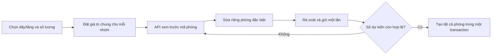

# Hướng dẫn triển khai tạo nhiều phòng theo dãy/tầng

Tài liệu này giải thích thứ tự triển khai và các đoạn code quan trọng. Chức năng đã được thêm vào dự án; xem [ROOM_BATCH_CREATION_CHANGES.md](ROOM_BATCH_CREATION_CHANGES.md) để biết quy trình thực tế và cách kiểm tra. API `POST /api/properties/{propertyId}/rooms` tạo một phòng thủ công vẫn được giữ để tương thích dữ liệu cũ.

## Kết quả mong muốn



Ví dụ: tầng 1 tạo 4 phòng `101`–`104`; mặc định diện tích 25 m², giá 2.500.000, tối đa 2 người. Phòng `103` là phòng góc: diện tích 30 m², giá 3.000.000. Tầng 2 có thể khai báo thêm trong **cùng một lượt**.

## Bước 1 — Chốt quy tắc và ranh giới dữ liệu

- Một khu trọ có thể quản lý theo tầng (`101`), dãy (`A01`) hoặc cả hai (`A101`). `RoomNumber` luôn là chuỗi.
- Số thứ tự `01`–`99` bắt đầu lại ở mỗi phạm vi: tầng 1, tầng 2, dãy A, dãy A/tầng 1... Một lượt đề xuất tối đa 200 phòng để tránh request và bảng xem trước quá lớn; giới hạn có thể điều chỉnh sau khi đo hiệu năng.
- Mỗi phòng là một bản ghi `Rooms` độc lập. “Giá trị chung” chỉ là mẫu nhập liệu; đổi mẫu về sau không tự đổi các phòng đã tạo.
- `RoomName`, `Area`, `BasePrice`, `MaxOccupants`, `Description` có thể khác nhau ở phòng đặc biệt. Chưa đưa ảnh/tiện nghi vào batch vì code hiện tại chưa có API ảnh hoặc danh mục tiện nghi phòng.

## Bước 2 — Thêm bảng dãy, bộ đếm và khóa chống gửi lặp

Tạo các entity trong `backend/src/RoomManagement.Domain/Entities/`:

```csharp
public sealed class RoomRow
{
    public Guid Id { get; set; }
    public Guid PropertyId { get; set; }
    public string Code { get; set; } = null!; // A, B, D1
    public string Name { get; set; } = null!;
    public bool IsActive { get; set; } = true;
}

public sealed class RoomNumberCounter
{
    public Guid PropertyId { get; set; }
    public string ScopeKey { get; set; } = null!; // F:1, R:{id}, R:{id}:F:1
    public int LastSequence { get; set; }
}
```

Trong `Room.cs`, thêm `Guid? RowId` và `int? SequenceNumber`; giữ `RoomNumber`/`Floor` để dữ liệu cũ còn nguyên. Trong `RoomManagementDbContext.cs`, thêm `DbSet<RoomRow> RoomRows`, `DbSet<RoomNumberCounter> RoomNumberCounters` và `DbSet<RoomBatchSubmission> RoomBatchSubmissions`. `RoomBatchSubmission` lưu `PropertyId`, `OwnerUserId`, `IdempotencyKey`, `RequestHash`, `ResultJson` (kết quả của lần tạo đầu tiên) và thời gian tạo; khóa duy nhất `(PropertyId, OwnerUserId, IdempotencyKey)`.

Tạo `RoomRowConfiguration.cs`, `RoomNumberCounterConfiguration.cs`, `RoomBatchSubmissionConfiguration.cs` trong `backend/src/RoomManagement.Data/Configurations/`. Cấu hình:

```csharp
builder.HasIndex(x => new { x.PropertyId, x.Code }).IsUnique();
// Với RoomNumberCounter: khóa chính (PropertyId, ScopeKey).
// Với RoomBatchSubmission: unique index (PropertyId, OwnerUserId, IdempotencyKey).
```

Trong `RoomConfiguration.cs`, thêm FK `RowId -> RoomRows.Id` với `DeleteBehavior.NoAction` và index thường `(PropertyId, RowId, Floor, SequenceNumber)` để lọc/sắp xếp. Unique index `(PropertyId, RoomNumber)` hiện có là chốt chặn mã trùng cho cả phòng cũ và mới. Với phòng cũ, `RowId`/`SequenceNumber` là `NULL`; không đoán dãy từ mã phòng đã nhập tay.

Sau khi sửa model, từ gốc repo chạy:

```powershell
dotnet ef migrations add AddRoomBatchNumbering --project backend/src/RoomManagement.Data --startup-project backend/src/RoomManagement.API
dotnet ef database update --project backend/src/RoomManagement.Data --startup-project backend/src/RoomManagement.API
```

Đọc file migration trước khi chạy `database update`: xác nhận cột mới nullable, không đổi/xóa mã phòng cũ, không có thao tác phá dữ liệu. Cấu hình kết nối local theo `backend/README.md`.

Sau migration, tạo `backend/src/RoomManagement.API/Controllers/RoomRowsController.cs` và service/store tương ứng. Cần tối thiểu `GET /api/properties/{propertyId}/rows` và `POST /api/properties/{propertyId}/rows` để chọn/tạo dãy trước khi tạo phòng; thêm `PUT /rows/{rowId}` để đổi tên hoặc ngừng dùng dãy. `POST` kiểm tra chủ trọ sở hữu khu trọ, code được chuẩn hóa và không trùng trong cùng khu. Không xóa dãy đã có phòng; không đổi code khi dãy đã có phòng vì mã phòng đã cấp dùng tiền tố đó. Frontend thêm API trong `frontend/src/services/api/RoomRowApi.js` và export từ `frontend/src/services/api.js`; tại `CreateRoomPage.jsx`, tải danh sách dãy để chọn hoặc mở giao diện tạo dãy.

## Bước 3 — Viết hàm cấp số thuần

Tạo `backend/src/RoomManagement.Business/Services/RoomNumbering.cs`. Dùng cùng hàm ở preview và lúc lưu:

```csharp
public static string Format(string? rowCode, int? floor, int sequence)
{
    if (sequence is < 1 or > 99) throw new ArgumentOutOfRangeException(nameof(sequence));
    if (floor is <= 0) throw new ArgumentOutOfRangeException(nameof(floor));
    var prefix = rowCode is null ? "" : rowCode.ToUpperInvariant();
    return floor is null
        ? $"{prefix}{sequence:00}"
        : $"{prefix}{floor}{sequence:00}";
}
```

Không cho `rowCode` và `floor` cùng rỗng trong batch. Kiểm tra mã dãy chỉ gồm chữ/số viết hoa, không dấu. Trước khi cấp số trong khu trọ cũ, đọc các `RoomNumber` đã có trong phạm vi và bỏ qua mã trùng; bộ đếm không giảm khi xóa phòng. Nếu không đủ số tới `99`, trả lỗi `ROOM_NUMBER_CAPACITY_EXCEEDED`.

## Bước 4 — Định nghĩa request/response riêng cho batch

Tạo `backend/src/RoomManagement.API/Contracts/Rooms/RoomBatchRequests.cs`. Không sửa `CreateRoomRequest` cũ. DTO tối thiểu:

```csharp
public sealed record BatchGroupRequest(
    string ClientKey, Guid? RowId, int? Floor, int Count, RoomValuesRequest Defaults);

public sealed record RoomValuesRequest(
    string? RoomName, decimal? Area, decimal BasePrice,
    int MaxOccupants, string? Description);

public sealed record RoomOverrideRequest(
    string GroupKey, int Ordinal, RoomValuesRequest Values);

public sealed record BatchPreviewRequest(
    IReadOnlyList<BatchGroupRequest> Groups,
    IReadOnlyList<RoomOverrideRequest> Overrides);

public sealed record BatchCreateRequest(
    IReadOnlyList<BatchGroupRequest> Groups,
    IReadOnlyList<RoomOverrideRequest> Overrides,
    string PreviewFingerprint, Guid IdempotencyKey);
```

`Ordinal` bắt đầu từ 1 **trong nhóm**, chẳng hạn `floor-1`/`3` ứng với phòng `103` ở bản xem trước. `RoomOverrideRequest.Values` chứa **đầy đủ** giá trị cuối cùng của phòng đặc biệt, không phải JSON patch; điều này tránh nhập nhằng giữa “kế thừa” và `null` (xóa trường tùy chọn).

Ví dụ body của preview:

```json
{
  "groups": [
    { "clientKey": "floor-1", "rowId": null, "floor": 1, "count": 4,
      "defaults": { "roomName": null, "area": 25, "basePrice": 2500000, "maxOccupants": 2, "description": null } },
    { "clientKey": "floor-2", "rowId": null, "floor": 2, "count": 4,
      "defaults": { "roomName": null, "area": 25, "basePrice": 2500000, "maxOccupants": 2, "description": null } }
  ],
  "overrides": [
    { "groupKey": "floor-1", "ordinal": 3,
      "values": { "roomName": "Phòng góc", "area": 30, "basePrice": 3000000, "maxOccupants": 2, "description": "Có ban công" } }
  ]
}
```

Preview trả `groups`/`rooms` đã tính, `roomNumber` dự kiến, `clientKey`, `ordinal`, `values`, lỗi theo phòng nếu có, và `previewFingerprint`. Khi tạo, gửi lại body trên cùng `previewFingerprint` và `idempotencyKey` mới. Fingerprint do server tính từ **kế hoạch đã chuẩn hóa và toàn bộ mã dự kiến**; client không tự tính.

## Bước 5 — Tạo nghiệp vụ kiểm tra kế hoạch và preview

Tạo `backend/src/RoomManagement.Business/Services/RoomBatchService.cs` và `backend/src/RoomManagement.Business/Interfaces/IRoomBatchStore.cs`. Đăng ký service bằng `builder.Services.AddScoped<RoomBatchService>()` trong `backend/src/RoomManagement.API/Program.cs`, cùng nơi đang đăng ký `RoomService`; đăng ký store trong `backend/src/RoomManagement.Data/ServiceCollectionExtensions.cs`.

Trong `PreviewAsync`:

1. Lấy chủ trọ từ `ICurrentLandlord`, kiểm tra landlord hoạt động; lấy property bằng `IPropertyStore.GetAsync(propertyId, ownerId, ct)` như `RoomService` hiện tại. Chặn khu trọ ngừng hoạt động.
2. Kiểm tra mỗi `RowId` thuộc đúng property và còn hoạt động; `Floor >= 1`; `Count >= 1`; tổng `Count <= 200`; không có hai nhóm cùng `RowId`/`Floor`; `ClientKey` duy nhất.
3. Kiểm tra `Ordinal` trong `1..Count`, không có hai override cho cùng nhóm/vị trí; áp dụng quy tắc `PropertyRoomValidation.Room` cho **giá trị cuối cùng** của từng phòng. Có thể trích hàm validate giá trị từ validator hiện có.
4. Store đọc bộ đếm và mã phòng đã tồn tại, tạo danh sách số dự kiến theo `RoomNumbering.Format`. Tính fingerprint từ kế hoạch chuẩn hóa + mapping `(ClientKey, Ordinal, RoomNumber)`.

Không tạo bản ghi hoặc tăng bộ đếm trong preview; preview không giữ chỗ số phòng.

## Bước 6 — Lưu batch có khóa, transaction và idempotency

Tạo `backend/src/RoomManagement.Data/RoomBatchStore.cs`. Logic trọng tâm (mô tả theo thứ tự, không phải code thay thế nguyên file):

```csharp
await using var tx = await db.Database.BeginTransactionAsync(
    System.Data.IsolationLevel.Serializable, ct);

// 1. Kiểm tra idempotencyKey trong cùng PropertyId + OwnerUserId.
//    Cùng key + cùng RequestHash: trả kết quả đã lưu.
//    Cùng key + khác RequestHash: 409 BATCH_KEY_REUSED.
// 2. Khóa các scope theo ScopeKey đã sort, luôn cùng thứ tự.
// 3. Đọc counter và RoomNumber đang tồn tại; tính lại mã phòng.
// 4. So sánh fingerprint. Nếu khác: 409 ROOM_PREVIEW_CHANGED.
// 5. AddRange(Room), cập nhật counters, ghi bản ghi idempotency.
await db.SaveChangesAsync(ct);
await tx.CommitAsync(ct);
```

Với SQL Server, có thể dùng `sys.sp_getapplock` theo từng `PropertyId`/`ScopeKey` trong transaction để serialize cả khi counter chưa tồn tại. Kiểm tra mã trả về âm và rollback khi không lấy được khóa. Mọi đường ghi số tự động phải đi qua cùng cơ chế; unique index `(PropertyId, RoomNumber)` vẫn bắt xung đột với API nhập tay cũ. Chuyển lỗi unique thành `409`, rollback toàn bộ; không để sót một phần batch. Không giữ transaction trong lúc người dùng xem form. [EF Core transactions](https://learn.microsoft.com/en-us/ef/core/saving/transactions), [SQL Server application locks](https://learn.microsoft.com/en-us/sql/relational-databases/system-stored-procedures/sp-getapplock-transact-sql).

Nếu code có bật retry strategy `EnableRetryOnFailure`, bọc **toàn bộ transaction** trong execution strategy của EF Core; không retry riêng `SaveChangesAsync` bên trong transaction. [EF Core connection resiliency](https://learn.microsoft.com/en-us/ef/core/miscellaneous/connection-resiliency).

## Bước 7 — Gắn API vào controller

Trong `backend/src/RoomManagement.API/Controllers/RoomsController.cs`, inject thêm `RoomBatchService` và thêm hai action **trước route `"{roomId:guid}"` cho dễ đọc**:

```csharp
[HttpPost("batch/preview")]
public async Task<IActionResult> PreviewBatch(
    Guid propertyId, [FromBody] BatchPreviewRequest request, CancellationToken ct)
    => Ok(new ApiResponse<BatchPreviewResponse>(
        await _batchService.PreviewAsync(propertyId, request.ToInput(), ct)));

[HttpPost("batch")]
public async Task<IActionResult> CreateBatch(
    Guid propertyId, [FromBody] BatchCreateRequest request, CancellationToken ct)
    => StatusCode(StatusCodes.Status201Created,
        new ApiResponse<BatchCreateResponse>(
            await _batchService.CreateAsync(propertyId, request.ToInput(), ct)));
```

Đây là **khung tích hợp**: cần tạo `BatchPreviewResponse`, `BatchCreateResponse`, input DTO và `ToInput()` tương ứng trước khi biên dịch. `[Authorize(Roles = UserRoles.Landlord)]` đã đặt trên controller, nhưng service vẫn phải kiểm tra quyền sở hữu property/row. `ApiExceptionHandler` hiện chuyển `BusinessErrorType.Conflict` thành HTTP 409; dùng mã `ROOM_PREVIEW_CHANGED` để frontend nhận biết.

Giữ `POST /rooms` cũ. Khi sửa phòng đã cấp số tự động, backend cần chặn thay `RoomNumber`, `RowId`, `Floor` qua `UpdateRoomRequest` thông thường; nếu cần chuyển vị trí thì tạo luồng riêng. Với phòng nhập tay cũ, giữ hành vi cũ.

## Bước 8 — Thêm API frontend

Trong `frontend/src/services/api/RoomApi.js`, thêm:

```js
export async function previewRoomBatch(propertyId, plan) {
  const response = await apiRequest(`${roomsPath(propertyId)}/batch/preview`, {
    method: 'POST', body: plan,
  })
  return response.data
}

export async function createRoomBatch(propertyId, plan) {
  const response = await apiRequest(`${roomsPath(propertyId)}/batch`, {
    method: 'POST', body: plan,
  })
  invalidateApiCache('rooms')
  return response.data
}
```

`frontend/src/services/api.js` đã export toàn bộ `RoomApi.js`, nên không cần thêm export ở nơi khác. `apiRequest` tự gắn Bearer token và ném `ApiError` có `status`/`details`.

## Bước 9 — Tạo wizard trên trang tạo phòng

Thay phần dùng `RoomForm` trong `frontend/src/pages/CreateRoomPage.jsx` bằng component mới `frontend/src/components/rooms/RoomBatchWizard.jsx`. Giữ `RoomForm.jsx` cho trang sửa phòng và nếu muốn giữ nút “Tạo một phòng thủ công”. Chia component thành `BatchGroupsStep.jsx`, `BatchPreviewStep.jsx`, `BatchReviewStep.jsx` để trang không chứa toàn bộ logic.

State đề xuất:

```js
const [groups, setGroups] = useState([])
const [overrides, setOverrides] = useState({}) // key: `${clientKey}:${ordinal}`
const [preview, setPreview] = useState(null)
const [idempotencyKey, setIdempotencyKey] = useState(() => crypto.randomUUID())
const [busy, setBusy] = useState(false)
```

- Bước nhóm: chọn dãy/tầng, số lượng, giá trị chung; cho sao chép nhóm. Kiểm tra tổng số trước khi gọi API.
- Bước preview: gọi `previewRoomBatch`. Bảng hiển thị mã phòng, các giá trị cuối cùng và đánh dấu phòng đặc biệt. Khi sửa một phòng, lưu **đầy đủ** `RoomValuesRequest` vào `overrides`; khi đổi nhóm/số lượng hoặc giá trị phòng, xóa fingerprint cũ và gọi preview lại trước khi lưu.
- Bước rà soát: tổng số, số phòng đặc biệt và giá trị khác mặc định. Nút lưu chỉ bật khi preview hiện tại khớp kế hoạch đang hiển thị. Dùng icon Lucide qua `IconButton` hiện có; thông báo bằng `notify`/`Feedback`, không dùng `window.confirm`.
- Khi gửi batch, giữ cùng `idempotencyKey` cho retry do mất mạng. Sau thành công, sinh key mới cho lượt kế tiếp. Với lỗi `409`/`ROOM_PREVIEW_CHANGED`, giữ dữ liệu form, gọi preview mới và yêu cầu người dùng rà soát lại phòng đặc biệt.

Ví dụ xử lý xung đột:

```js
try {
  const result = await createRoomBatch(propertyId, {
    groups, overrides: Object.values(overrides),
    previewFingerprint: preview.previewFingerprint,
    idempotencyKey,
  })
  notify(`Đã tạo ${result.rooms.length} phòng.`)
  navigate(`landlord/properties/${propertyId}/rooms`)
} catch (error) {
  if (error.status === 409 && error.details?.code === 'ROOM_PREVIEW_CHANGED') {
    setPreview(null)
    setError('Số phòng đã thay đổi. Hãy xem lại các phòng đặc biệt rồi xác nhận tiếp.')
  } else setError(error.message)
}
```

Với hàng trăm phòng, chỉ hiển thị các hàng đang nhìn thấy hoặc phân trang bảng xem trước; không render 200 form mở cùng lúc. Nút “Tạo nhiều phòng” nên là hành động chính tại `RoomManagementPage.jsx`. Có thể giữ URL `#/landlord/properties/{id}/rooms/new` và đổi nội dung trang, nên không cần sửa router trong `App.jsx` ở giai đoạn đầu.

## Bước 10 — Kiểm thử đúng các ranh giới

Thêm unit test vào `backend/tests/RoomManagement.Business.Tests/`: `Format(null,1,1) == "101"`, `Format("A",1,3) == "A103"`; nhóm trùng, ordinal ngoài phạm vi, giá/diện tích/sức chứa sai, >99 trong một scope và >200 tổng đều bị từ chối.

Thêm SQL integration test vào `backend/tests/RoomManagement.Tests/` với DB test riêng: tạo 2 nhóm trong một lượt; phòng `103` nhận giá trị riêng; hai request đồng thời không trùng số; fingerprint cũ trả 409; một nhóm lỗi không tạo dở nhóm kia; gửi lại cùng idempotency key trả cùng phòng. Kiểm tra API nhập tay cũ và phòng cũ vẫn hoạt động. Xem `backend/README.md` trước khi chạy SQL test vì test cần `ROOMMANAGEMENT_TEST_SQLSERVER` và quyền tạo/xóa DB test.

Chạy từ gốc repo:

```powershell
dotnet test backend/RoomManagement.sln
npm --prefix frontend run build
```

## Giai đoạn sau: ảnh và tiện nghi

`RoomService` trong domain hiện là liên kết **dịch vụ tính phí**, không phải tiện nghi. Nếu cần máy lạnh, ban công, nội thất, tạo `Amenity` và `RoomAmenity` riêng. Nếu cần ảnh, tạo `RoomImage` chứa metadata/đường dẫn lưu trữ và API upload theo `RoomId`; không lưu ảnh nhị phân trong `Rooms`. Có thể chọn tiện nghi mặc định theo nhóm và ghi đè theo phòng sau khi có bảng/API tương ứng. Upload ảnh nên thực hiện sau khi tạo phòng, có cơ chế thử lại nếu upload lỗi; nếu ảnh là điều kiện bắt buộc trước khi đưa phòng vào khai thác, cần thêm trạng thái nháp/kích hoạt vì hiện phòng mới mặc định `Available`.
