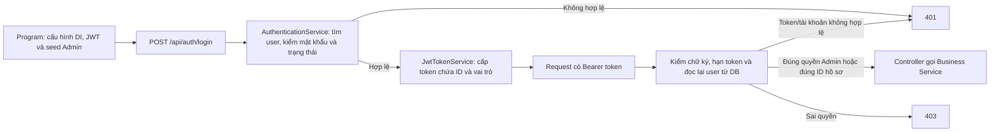
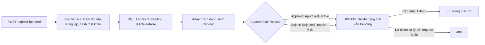

# Luồng tài khoản, hồ sơ và duyệt chủ trọ

Tài liệu này mô tả **code hiện tại** trong `backend/src`. Một request đi theo chiều: **Controller (API) → Service (Business) → interface store (Business) → store EF (Data) → SQL Server**. Controller nhận/trả HTTP; Service quyết định quy tắc; store truy vấn và ghi dữ liệu.

## Khởi động và đăng nhập

| File | Cách xử lý |
| --- | --- |
| `src/RoomManagement.API/Program.cs` | Đăng ký Data, Business, JWT; kiểm cấu hình JWT, chạy seed Admin rồi gắn middleware authentication/authorization. Lỗi seed thực sự làm ứng dụng dừng khởi động. |
| `src/RoomManagement.Data/Seeders/AdminUserSeeder.cs` | Bỏ qua khi không cấu hình mật khẩu hoặc đã có Admin; nếu cần tạo Admin thì kiểm cấu hình, tránh trùng username/email và lưu password hash. |
| `src/RoomManagement.API/Controllers/AuthController.cs` | Nhận login; thông tin sai hoặc tài khoản chưa được phép truy cập trả `401`, đúng trả token. |
| `src/RoomManagement.Business/Services/AuthenticationService.cs` | Tìm theo username/email, so mật khẩu hash, chỉ cho tài khoản `IsActive = true` và `ApprovalStatus = Approved` đăng nhập. |
| `src/RoomManagement.API/Authentication/JwtTokenService.cs` | Tạo JWT chứa ID (`sub`), vai trò (`role`) và thời hạn. |
| `src/RoomManagement.API/Authentication/AuthenticationExtensions.cs`, `CurrentUserJwtEvents.cs` | Kiểm chữ ký, issuer, audience, hạn; mỗi request đọc lại user để từ chối token nếu tài khoản bị khóa, đổi vai trò hoặc không còn được duyệt. |
| `src/RoomManagement.Data/Stores/UserStore.cs` | Dùng EF để tìm user và lưu thay đổi; trường hợp username/email cùng khớp hai tài khoản hiện trả kết quả rỗng. |

## Đăng ký, hồ sơ và duyệt chủ trọ

| Luồng và file chính | Cách xử lý |
| --- | --- |
| `AuthController.cs` → `UserService.RegisterLandlordAsync` → `UserStore.cs` | Đăng ký chủ trọ: kiểm email, hồ sơ và CCCD; kiểm trùng; lưu password hash cùng trạng thái `Pending`/inactive; trả `201`. `AppUserConfiguration.cs` dùng EF sentinel để giá trị `IsActive=false` được ghi thật xuống DB. |
| `AdminUsersController.cs` → `UserService.CreateUserByAdminAsync` | Chỉ Admin được tạo Tenant/Landlord. Service kiểm vai trò, email, trùng username/email; tài khoản mới ở trạng thái `Approved`/active; trả `201` với `UserResponse.FromDto`. |
| `UsersController.cs` → `UserService.GetProfileStatusAsync` / `CompleteProfileAsync` | Cần Bearer token có `sub` trùng `{id}` trên URL. Service kiểm trường bắt buộc theo vai trò, định dạng và CCCD trùng trước khi lưu; trả `200`, sai dữ liệu `400`, trùng `409`. |
| `AdminUsersController.cs` → `LandlordApprovalService.cs` → `LandlordApprovalStore.cs` | Chỉ Admin xem, duyệt hoặc từ chối hồ sơ `Pending`. Store cập nhật có điều kiện `ApprovalStatus = Pending`; một request thành công, request đến sau nhận `409`. |
| `UserProfileRules.cs`, `UserAccountRules.cs` | Quy tắc độ tuổi, điện thoại, CCCD, hồ sơ bắt buộc và email tối đa 256 ký tự. |

`UserStore.cs` chuyển lỗi unique SQL Server `2601/2627` khi lưu `AppUser` thành conflict `409`; lỗi database khác vẫn là lỗi hệ thống. Các controller ánh xạ lỗi validation, không tìm thấy và conflict thành `400/404/409`.

**Giới hạn hiện tại:** login chưa có rate limit. Username có thể trùng email của tài khoản khác; khi đó đăng nhập bằng chuỗi bị trùng sẽ thất bại, dù tài khoản vẫn có thể dùng username riêng.
